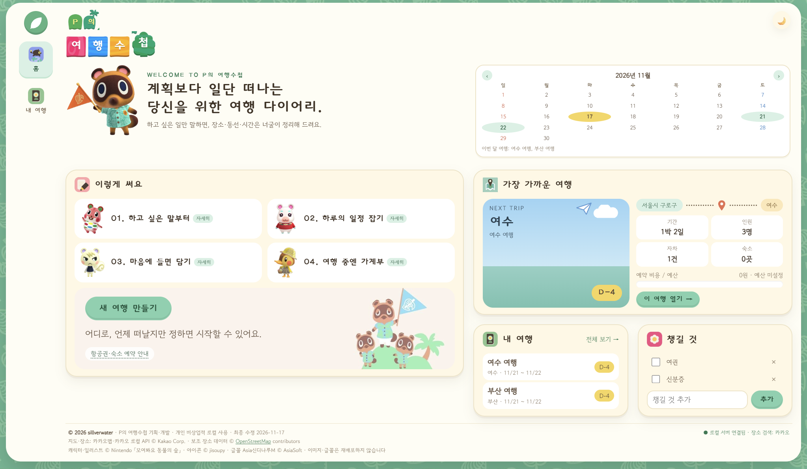
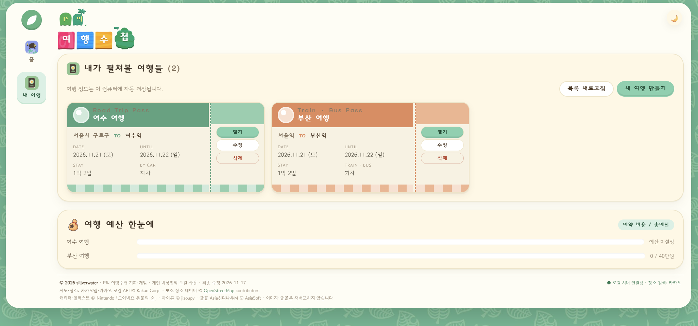
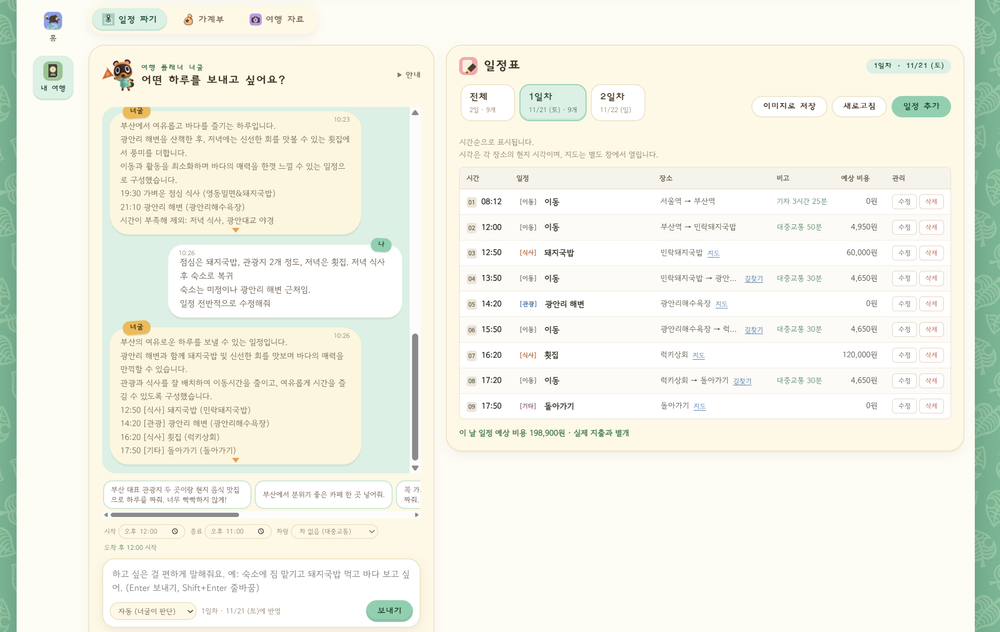
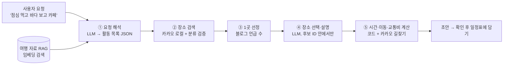

# P의 여행수첩

> 하고 싶은 것만 말하면 장소, 동선, 시간은 AI 플래너가 정리해 주는 **여행 다이어리**

MBTI의 마지막 글자 **P**는 계획보다 즉흥을, 정해진 일정보다 그때그때의 선택을 좋아하는 성향이에요.  
P형 여행자는 "어디 갈지는 대충 정했는데… 몇 시에 뭘 하지?"에서 막히곤 하죠.  
이 앱은 그런 P를 위해 만들었어요.  

- 엑셀로 시간표를 짜는 대신, **"점심 먹고 바다 보고 카페 갈래"처럼 대충 말하면** 됩니다.
- 실제 가게 찾기, 동선, 이동 시간, 교통비, 예약 시각 맞추기 같은 **J의 일은 너굴(AI)이** 대신해요.
- 마음이 바뀌면 "저녁은 횟집으로 바꿔줘"라고 말하면 하루 흐름을 다시 맞춰 줘요. 계획이 바뀌는 것도 P다운 여행이니까요.

---

## 무엇을 할 수 있나요?

| 기능 | 설명 |
|---|---|
| 여행 만들기 | 여행지, 기간, 인원, 예산, 가는 방법(비행기 / 기차·버스 / 자차), 숙소를 입력해요. |
| AI 일정 짜기 | "점심 먹고 바다 보고 카페 갈래"처럼 말하면 너굴이 하루 일정 초안을 만들어요. |
| 장소 추천 | 카카오 장소 검색 결과 중 블로그 언급이 가장 많은 곳 하나를 추천해요. |
| 이동 시간·교통비 | 장소 사이에 이동 일정을 자동으로 넣고, 걸리는 시간과 예상 교통비(대중교통 / 택시 / 자동차)를 계산해요. |
| 일정표 | 날짜별로 보고, 직접 고치고, 지도·길찾기(카카오맵)를 열고, 이미지로 저장할 수 있어요. |
| 가계부 | 여행 중 쓴 돈을 기록하고 예산과 비교해요. |
| 여행 자료 | 예약 확인서·메모(PDF, 엑셀, 이미지 등)를 올리면 AI가 내용을 찾아 주고, 인식된 글자를 미리 볼 수 있어요. |
| 예약 안내문 자동 입력 | 항공·숙소 확인 메일을 붙여 넣으면 입력 칸을 자동으로 채워요. |

모든 데이터는 **내 컴퓨터에만** 저장돼요. 다른 사람과 공유되지 않아요.

---

## 화면

### 1. 홈
달력, 가장 가까운 여행, 내 여행 목록, 챙길 것을 한 화면에서 봐요.



### 2. 내 여행
여행마다 티켓으로 정리되고, 출발지·도착지·기간·이동 수단이 표시돼요.



### 3. 일정 짜기 · 일정표
너굴과 대화하면 초안이 만들어지고, 오른쪽 일정표에 [관광]·[식사]·[이동] 순서로 시간·이동 수단·예상 비용과 함께 정리돼요.



---

## 기술 스택

| 구분 | 사용 기술 |
|---|---|
| 프론트엔드 | HTML · CSS · JavaScript (ES 모듈, 프레임워크·빌드 도구 없음), Canvas API(일정표 이미지 저장) |
| 백엔드 | Python FastAPI, SQLite |
| AI | OpenAI API — `gpt-4o-mini`(Structured Outputs, 멀티모달), `text-embedding-3-small`(RAG) |
| 지도·장소 | 카카오 로컬 API, 다음 블로그 검색 API, 카카오모빌리티 길찾기 API, OpenStreetMap(OSRM 도보 경로·보완 검색) |

## 일정이 만들어지는 과정



- **LLM은 말을 정리하고 고르는 일만**, 장소·거리·시간·요금은 실제 지도 데이터와 코드가 계산해서 없는 가게를 지어내지 않아요.
- 항공·기차·버스·자차의 도착·출발 시각, 숙소, 이전 대화의 취향을 함께 고려하고, 예약과 충돌하면 먼저 되물어요.
- 저장된 일정이 있으면 "추가"인지 "흐름 수정"인지 너굴이 판단해 하루 흐름을 다시 맞춰요.

---

## 1. 준비물

| 준비물 | 비용 | 용도 |
|---|---|---|
| Anaconda (또는 Miniconda) | 무료 | 파이썬 실행 환경 만들기 |
| 카카오 REST API 키 | 무료 (하루 한도 넉넉함) | 장소 검색, 블로그 언급 수, 길찾기·택시비 |
| OpenAI API 키 | **유료** (사용한 만큼) | AI 일정 짜기, 안내문 읽기, 자료 검색 |

> OpenAI 키가 없어도 여행 만들기, 일정 직접 입력, 가계부는 쓸 수 있어요. AI 기능만 안 돼요.

### Anaconda 설치

1. [Anaconda 다운로드](https://www.anaconda.com/download) 페이지에서 내 운영체제용 설치 파일을 받아 설치합니다.
   - 가볍게 쓰고 싶다면 [Miniconda](https://docs.anaconda.com/miniconda/)도 똑같이 쓸 수 있어요.
   - Windows 설치 중 옵션은 기본값 그대로 두면 됩니다.
2. 설치 확인
   - Windows: 시작 메뉴에서 **Anaconda Prompt**를 엽니다.
   - macOS / Linux: 터미널을 새로 엽니다.
   ```bash
   conda --version
   ```
   `conda 24.x.x`처럼 버전이 나오면 준비 끝이에요.

---

## 2. API 키 발급받기

### 2-1. 카카오 REST API 키 (무료)

1. [카카오 디벨로퍼스](https://developers.kakao.com)에 카카오 계정으로 로그인합니다.
2. 위쪽 메뉴 **내 애플리케이션** → **애플리케이션 추가하기**를 누릅니다.
   - 앱 이름, 회사명은 아무거나 적어도 됩니다. (예: `여행수첩`, `개인`)
3. 만든 앱을 누르고 **앱 키**(또는 앱 설정 → 앱 키) 화면에서 **REST API 키**를 복사합니다.
4. **카카오맵 사용 설정을 켭니다.**
   - 왼쪽 메뉴에서 **카카오맵**(제품 설정 아래)을 찾아 **사용 설정 ON**으로 바꿉니다.
   - 이걸 켜지 않으면 장소 검색이 "권한 없음"으로 실패해요.
5. 복사한 키를 아래 [3. 설정 파일 만들기](#3-설치하기)에서 `KAKAO_REST_API_KEY=` 뒤에 붙여 넣습니다.

> 자동차 길찾기·택시비는 카카오모빌리티 길찾기 API를 **같은 REST 키**로 사용해요.
> 길찾기만 실패하면 프로그램이 거리로 추정한 값으로 대신 계산하니, 다른 기능은 그대로 쓸 수 있어요.

### 2-2. OpenAI API 키 (유료)

1. [OpenAI Platform](https://platform.openai.com)에 가입·로그인합니다.
   - ChatGPT 구독(Plus)과는 **별개**예요. API는 따로 결제해야 해요.
2. **Settings → Billing**에서 결제 수단을 등록하고 크레딧을 충전합니다. (5달러 정도면 한참 써요)
3. **API keys** → **Create new secret key**를 눌러 키를 만들고 바로 복사합니다.
   - 키는 만들 때 한 번만 보여요. 잃어버리면 새로 만들면 돼요.
4. 복사한 키를 `.env`의 `OPENAI_API_KEY=` 뒤에 붙여 넣습니다.

> **키는 비밀번호와 같아요.** 다른 사람에게 보내거나 깃허브·카톡에 올리지 마세요.
> 사용 한도를 걸어 두려면 OpenAI의 Settings → Limits에서 월 사용 한도를 정할 수 있어요.

---

## 3. 설치하기

아래 명령은 **Anaconda Prompt**(Windows) 또는 **터미널**(macOS / Linux)에서 차례로 실행합니다.

### 3-1. 프로젝트 받기

```bash
git clone https://github.com/sillverwater/p-travel-diary.git
cd p-travel-diary
```

> git이 없다면 GitHub 페이지의 **Code → Download ZIP**으로 받아 압축을 풀고, `cd 압축푼경로\p-travel-diary`로 이동하세요.

### 3-2. conda 가상환경 만들기 (한 번만)

```bash
conda create -n travel python=3.12 -y
conda activate travel
```

- `travel`은 환경 이름이에요. 다른 이름을 써도 됩니다.
- 프롬프트 맨 앞이 `(base)`에서 **`(travel)`** 로 바뀌면 켜진 거예요.

### 3-3. 필요한 패키지 설치

```bash
pip install -r requirements.txt
```

### 3-4. 설정 파일 만들기

```bash
# Windows (Anaconda Prompt)
copy .env.example .env
notepad .env

# macOS / Linux
cp .env.example .env
nano .env        # 또는 원하는 편집기로 열기
```

### `.env` 채우기

열린 `.env` 파일에서 두 줄을 채우고 저장합니다.

```dotenv
OPENAI_API_KEY=sk-...본인 키...
KAKAO_REST_API_KEY=...본인 카카오 REST API 키...
```

- `=` 앞뒤에 띄어쓰기나 따옴표를 넣지 마세요.
- 나머지 줄은 그대로 두면 됩니다.

---

## 4. 실행하기

conda 환경이 켜진 상태에서(프롬프트 앞에 `(travel)`이 보이면 켜진 것):

```bash
python run.py
```

터미널에 `P의 여행수첩: http://127.0.0.1:8000`이 나오면 브라우저에서 **http://127.0.0.1:8000** 을 엽니다.

- 끄기: 터미널에서 `Ctrl + C`
- 다음에 다시 켤 때: Anaconda Prompt(또는 터미널) 열기 → `conda activate travel` → 프로젝트 폴더로 `cd` → `python run.py`
- `.env`를 고쳤다면 서버를 껐다가 다시 켜야 반영돼요.

### 키가 잘 들어갔는지 확인

서버를 켠 상태에서 브라우저로 **http://127.0.0.1:8000/api/diagnostics/kakao** 를 엽니다.
`local_keyword`, `blog_search`, `car_directions`의 `"ok": true`가 보이면 카카오 키가 정상이에요. (키 값 자체는 화면에 나오지 않아요.)

---

## 5. 사용 순서

1. **새 여행 만들기**: 여행지, 날짜, 인원, 예산, 가는 방법을 입력합니다. 항공편·숙소를 넣으면 일정에 자동 반영돼요.
2. **내 여행**에서 티켓을 눌러 여행을 엽니다.
3. **일정 짜기** 탭에서 날짜 탭을 고르고, 입력창 위의 시작·종료 시각과 차량 유무를 정한 뒤 하고 싶은 걸 말합니다.
4. 너굴이 만든 **초안**을 확인하고 "내 다이어리에 담기"를 누르면 일정표에 저장돼요.
5. 일정표에서 직접 고치거나, 지도·길찾기를 열거나, 이미지로 저장할 수 있어요.
6. 여행 중에는 **가계부**, 예약 확인서는 **여행 자료**에 올려 두세요.

> 추천 장소, 영업시간, 가격, 교통비는 **AI·지도 데이터 기반 추정**이에요. 출발 전에 카카오맵에서 꼭 확인하세요.

---

## 6. 비용 안내

| 항목 | 비용 |
|---|---|
| 카카오 API | 무료 (개인 사용량은 무료 한도 안) |
| OpenStreetMap 보완 검색 | 무료 |
| OpenAI (gpt-4o-mini 기준) | 일정 한 번 짜기에 보통 몇 원~수십 원 수준. 이미지·긴 PDF를 올리면 조금 더 나와요. |

사용량은 [OpenAI Usage](https://platform.openai.com/usage)에서 확인할 수 있어요.

---

## 7. 데이터 저장 위치

- 여행, 일정, 가계부, 대화, 올린 자료의 글자는 모두 `data/travel.db` 한 파일에 저장돼요.
  - `data` 폴더는 처음 실행할 때 자동으로 만들어져요.
- **백업**: 서버를 끈 뒤 `data/travel.db`를 복사해 두세요.
- **처음부터 다시**: 서버를 끈 뒤 `data/travel.db`를 지우면 빈 상태로 시작해요. (되돌릴 수 없어요)
- 올린 파일 원본은 저장하지 않고, 읽어낸 글자만 저장해요.

---

## 8. 문제 해결

| 증상 | 해결 |
|---|---|
| `conda`를 찾을 수 없음 | Windows는 일반 명령 프롬프트가 아니라 **Anaconda Prompt**에서 실행. macOS/Linux는 설치 후 터미널을 새로 열기 |
| `No module named fastapi` 등 | `conda activate travel`로 환경을 켠 뒤 `pip install -r requirements.txt` 다시 실행 |
| `address already in use` / 포트 사용 중 | `.env`의 `APP_PORT`를 `8001`로 바꾸고 `http://127.0.0.1:8001` 접속 |
| "OPENAI_API_KEY를 입력하고…" | `.env`에 키 입력 → 저장 → 서버 재시작 |
| "OpenAI 사용 한도 또는 잔액을 확인해주세요" | OpenAI Billing에서 크레딧 충전 |
| 장소가 엉뚱하거나 "OpenStreetMap" 출처만 나옴 | 카카오 키 확인 → 진단 주소에서 `ok: true`인지 확인 → 카카오맵 사용 설정 ON 확인 |
| 진단에서 `http_status: 401/403` | REST API 키가 맞는지, 카카오맵 사용 설정을 켰는지 확인 |
| 화면이 예전 모습 그대로 | 브라우저에서 `Ctrl + Shift + R` (강력 새로고침) |
| 그림이 동물 이모지로 보임 | 정상이에요. 공유본은 무료 이미지(OpenMoji)를 써요. 아래 '이미지 바꾸기' 참고 |

---

## 8-1. 인터넷으로 잠깐 공개하기 (체험용)

내 컴퓨터에서 서버를 켠 채로, 무료 Cloudflare 임시 주소로 다른 사람이 접속하게 하는 방법이에요.
키는 내 컴퓨터의 `.env`에만 있고 밖으로 나가지 않아요.

1. **체험용 OpenAI 키를 새로 만들고 사용 한도를 겁니다.** (OpenAI → Settings → Limits, 예: 월 5달러) 체험이 끝나면 그 키를 삭제하세요.
2. **[cloudflared](https://developers.cloudflare.com/cloudflare-one/connections/connect-networks/downloads/) 설치** (가입 필요 없음)
   - Windows: `winget install --id Cloudflare.cloudflared`
   - macOS: `brew install cloudflared`
   - Ubuntu/WSL: `curl -L -o cloudflared.deb https://github.com/cloudflare/cloudflared/releases/latest/download/cloudflared-linux-amd64.deb && sudo dpkg -i cloudflared.deb`
3. **터미널 1: 공개 종료 시각과 체험용 DB를 정해서 서버 실행**
   - macOS/Linux: `PUBLIC_UNTIL=2026-11-18T09:00 APP_DATA_DIR=data-public python run.py`
   - Windows (Anaconda Prompt): `set "PUBLIC_UNTIL=2026-11-18T09:00" && set "APP_DATA_DIR=data-public" && python run.py`
4. **터미널 2: 임시 주소 만들기** → `cloudflared tunnel --url http://127.0.0.1:8000`
   - 출력에 나오는 `https://….trycloudflare.com` 주소를 공유하면 돼요.
5. **끝내기**: 두 터미널에서 `Ctrl + C`. 깜빡해도 `PUBLIC_UNTIL` 시각이 지나면 "체험 기간이 끝났어요" 화면만 보여요.

> 로그인 기능이 없어서 **접속한 사람 모두가 같은 여행 목록을 함께 봐요.** 그래서 `APP_DATA_DIR=data-public`으로 내 기록과 분리해 두는 거예요.
> AI 사용료는 공개한 사람의 키로 나가요.

---

## 9. 폴더 구조

```
Project/
├─ run.py              # 실행 파일
├─ requirements.txt    # 필요한 파이썬 패키지
├─ .env.example        # 설정 예시 (복사해서 .env로 사용)
├─ backend/            # 서버 (FastAPI)
│  ├─ main.py          # 앱 시작, 화면 제공
│  ├─ routers/         # 여행·일정·AI·지도·가계부·자료 API
│  └─ services/        # 카카오·OpenAI·길찾기·자료 처리
├─ frontend/           # 화면 (HTML · CSS · JavaScript)
└─ data/               # 내 데이터 (실행하면 자동 생성, 공유 금지)
```

---

## 10. 저작권 · 라이선스

- **P의 여행수첩** 기획·개발 © 2026 sillverwater.
- 장소 검색·지도: 카카오 로컬 API · 카카오맵 © Kakao Corp.
- 보조 장소 데이터: © [OpenStreetMap](https://www.openstreetmap.org/copyright) contributors (ODbL)
- 글꼴: 주아체(Jua), 고운돋움 — SIL Open Font License 1.1 (`frontend/fonts/OFL-*.txt`)
- 기본 아이콘·동물 캐릭터: [OpenMoji](https://openmoji.org) — CC BY-SA 4.0. 타일·배경은 직접 그린 이미지예요. 자세한 출처는 [`frontend/img-free/CREDITS.md`](frontend/img-free/CREDITS.md)
- README의 화면 캡처는 만든 사람의 개인 화면이라 「모여봐요 동물의 숲」 캐릭터(© Nintendo)가 보여요. 이 이미지들과 ACNH 아이콘(© jisoupy), Asia신디나루M 글꼴(© AsiaSoft)은 **저장소에 포함하지 않았어요.** 글꼴은 주아체로 대신 보여요.

### 이미지 바꾸기
`frontend/img/` 폴더를 만들고 [`frontend/img-free/`](frontend/img-free/)와 **같은 이름**으로 그림을 넣으면 그 그림이 우선 사용돼요(서버 재시작 필요 없음, 새로고침만).
`frontend/img/`는 `.gitignore`에 들어 있어서 GitHub에 올라가지 않아요. 저작권이 있는 그림은 이 폴더에만 두세요.
- AI 일정 추천은 OpenAI 모델이 만든 초안이며, 장소·영업·가격·교통비 정보는 사실과 다를 수 있어요.
